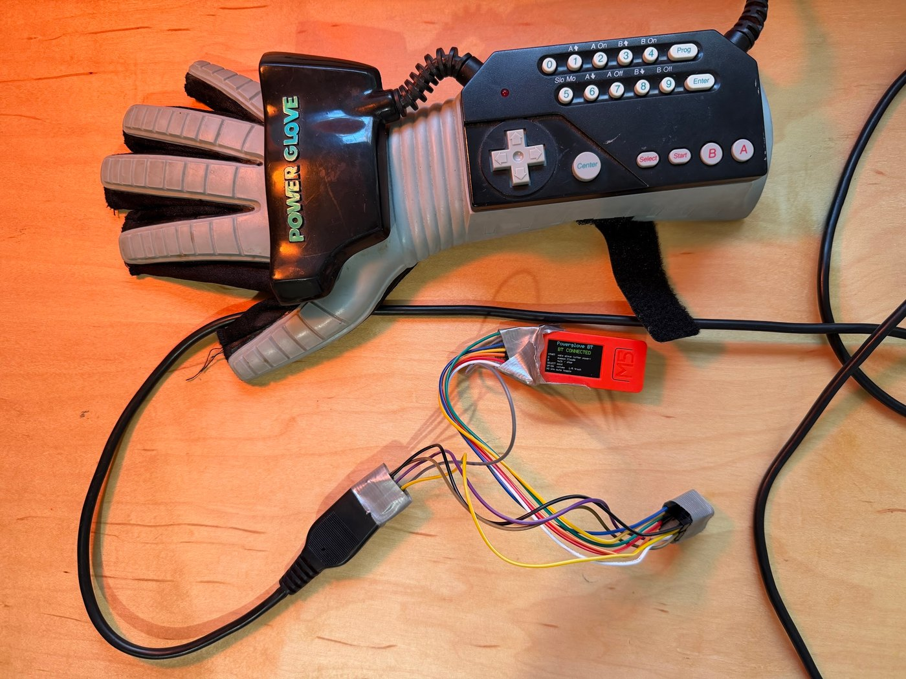
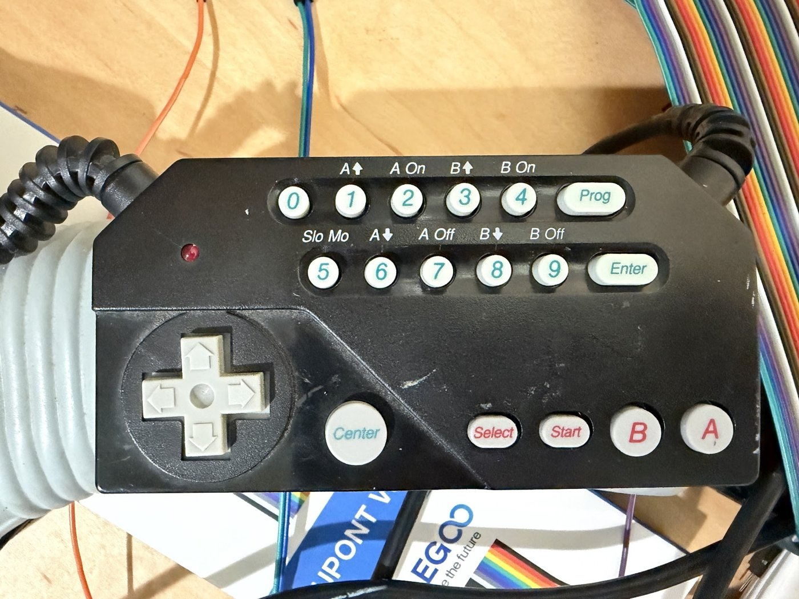
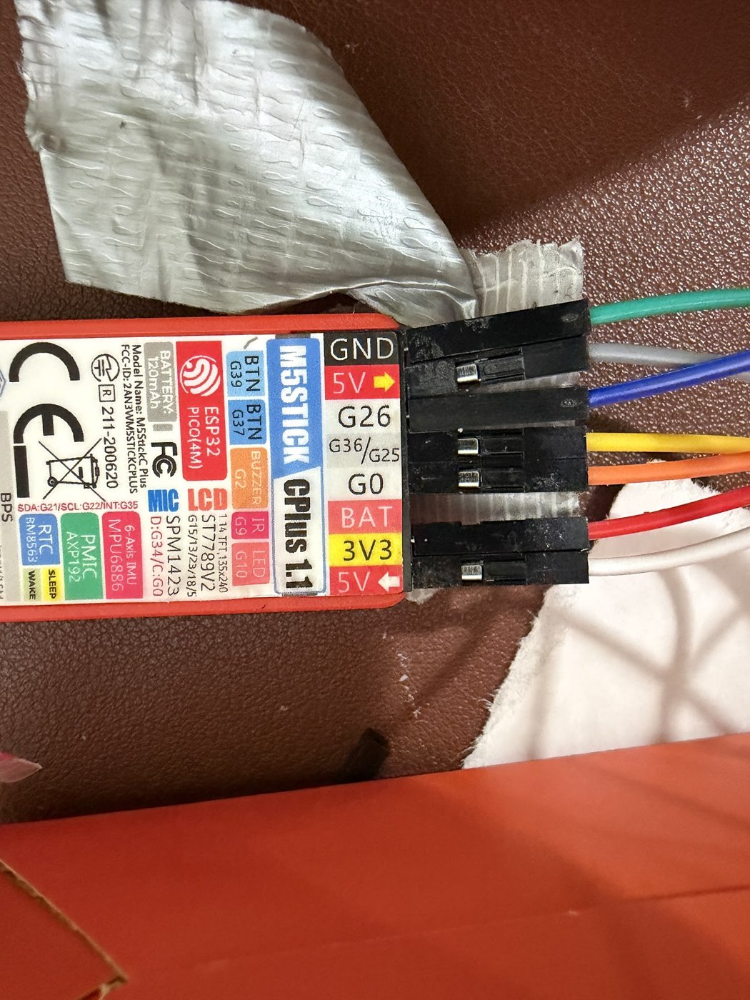
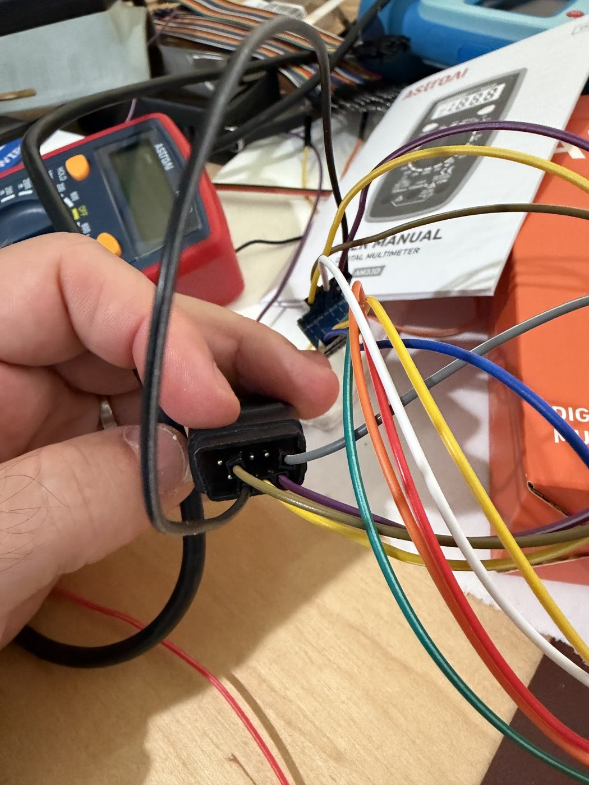
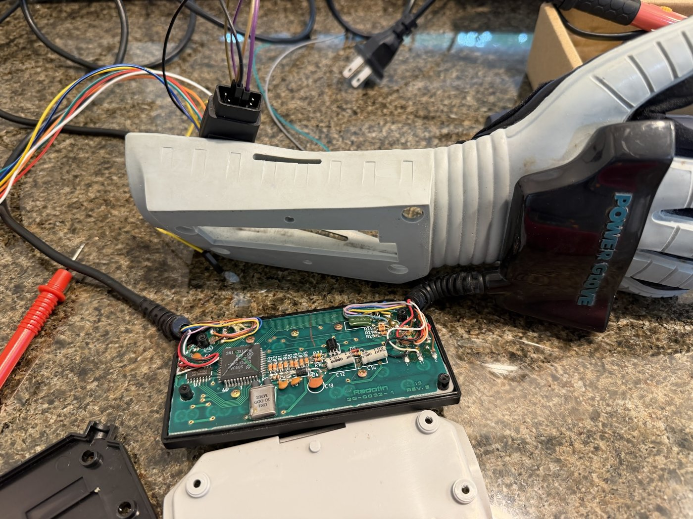

# Power Glove Bluetooth

*A 1989 Power Glove, turned into a Bluetooth keyboard. Nothing cut, nothing soldered.*



---

## The idea

Remember the Power Glove from the movie *The Wizard* (1989)? I took one out of storage and turned it into a Bluetooth Claude remote.

Make a fist, press **A**, and Claude's quick entry pops up over whatever you're doing. Press **B** and just talk. Press **Select** to send. I'm dictating to Claude through a 37-year-old Nintendo peripheral.

The glove speaks its original 1989 NES protocol, through its original plug, into a $20 M5Stack microcontroller with a tiny screen. The M5Stack introduces itself to a Mac as a boring Bluetooth keyboard, so there's nothing to install on the computer. It's fully wireless when the battery is charged.

Note: I'm a non-technical lawyer. I can't really code. I built this with [Claude Code](https://claude.com/claude-code), which patiently walked me through logic levels, level shifters, and some very confusing wire diagrams. Full disclosure: I work at Anthropic, which makes Claude. This is a personal project, not an Anthropic product.

### I wasn't first

Parsia Hakimian turned a Power Glove into an ESP32 Bluetooth keyboard for a DEF CON 33 talk in 2025, [The Power(Point) Glove](https://github.com/parsiya/PowerPointGlove), and published the code. I didn't see this while I was building mine. But I wish I had because it would've probably saved me a lot of time trying to figure out wiring diagrams.

What this repo adds: wiring for a 3.3-volt board with a screen and a battery, no soldering, a button map for Claude, and notes on two traps I fell into.

---

## The buttons



| Glove | Sends | Does |
|---|---|---|
| **Start** | nothing | Wakes the glove. Press it once after every power-up. |
| **A** | Option+Space | Opens Claude's quick entry |
| **B** | Caps Lock | Voice on and off |
| **Select** | Return | Send |
| **Up / Down** | Volume keys | Volume. Hold to repeat. |
| **Left / Right** | Media keys | Previous and next track |
| M5 button (on the Stick) | nothing | Mutes the glove. Press again to unmute. |

In the Claude desktop app on a Mac, go to Settings, General, and set the quick access shortcut to Option + Space and the voice shortcut to Caps Lock. Both are covered in Anthropic's help article, [Use quick entry with Claude Desktop on Mac](https://support.claude.com/en/articles/12626668-use-quick-entry-with-claude-desktop-on-mac).

**Leave the top two rows alone.** The numbers, Prog, Enter and Center are the glove's own 1989 settings menu, and pressing them reprograms what the glove sends. If it starts acting strange, pull its power wire, count to three, plug it back in, wait for the beep, and press Start.

It's just a keyboard, so none of this is really about Claude. Change the keys in `onPress()` and the glove can run your slides, your music or your game.

---

## BOM

| Qty | Description | ~Price | Notes |
|---|---|---|---|
| 1 | A Power Glove with its cable | eBay | Mine ends in a 9-pin plug. You don't need the sensor bars or the box they plug into. |
| 1 | [M5StickC Plus](https://docs.m5stack.com/en/core/StickC-Plus) | $20 | ESP32, screen, battery and USB-C in one orange box. Mine says "CPlus 1.1" on the back. See the note on the PLUS2 below. |
| 1 | BSS138 4-channel logic level shifter, with the header pins already on | $4 | [Adafruit's](https://www.adafruit.com/product/757) is the classic one but you solder its pins. Multi-packs with pins attached are easy to find. |
| 1 | Dupont jumper wires, female-to-female and male-to-female | $7 | The female ends push straight onto the pins of the glove's plug |
| 1 | A cheap multimeter | $13 | Optional. I had to learn to use one, and it was worth it. |
| | Tape | | |

About **$45**, plus a glove.

---

## 1. Wire it

The glove runs on 5 volts. The Stick's pins run on 3.3 volts and 5 will kill them. The level shifter sits in between and translates. It is not optional.

Hold the glove's plug with the pins facing you and the row of five on top. Pins 1 to 5 run left to right. Pins 6 to 9 run left to right underneath. Mine has tiny numbers molded into the plastic, so check yours.

| From | To | What it is |
|---|---|---|
| Glove pin 5 | Stick `5V` **out** (the hole next to `GND`) | Power for the glove |
| Glove pin 2 | Shifter `GND`, high-voltage side | Ground |
| Glove pin 7 | Shifter `HV1` | Latch |
| Glove pin 8 | Shifter `HV2` | Clock |
| Glove pin 9 | Shifter `HV3` | Data |
| Shifter `LV1` | Stick `G26` | Latch |
| Shifter `LV2` | Stick `G0` | Clock |
| Shifter `LV3` | Stick `G36` | Data |
| Shifter `HV` | Stick `5V` **in** (the far end of the header) | Tells the shifter what "high" means on the glove side |
| Shifter `LV` | Stick `3V3` | Same, on the Stick side |
| Shifter `GND`, low-voltage side | Stick `GND` | Ground |

Which channel carries which signal doesn't matter, as long as each wire goes in one side and out the other side of the same channel. `BAT` stays empty.

 

*Left: my Stick's header. Right: jumpers pushed straight onto pins 2, 5, 7, 8 and 9 of the glove's plug, with the little blue shifter behind. Both photos are from the middle of the build, and I swapped some jumpers afterward. Only the gray wire runs straight from one photo to the other. Go by the table, not the colors.*

**The voltage rule.** The glove needs a real 5 volts, and the shifter's `HV` must never sit above what the glove is getting. I tried the glove on the 4-volt `BAT` pin with 5-volt signals and got garbled, many-buttons-at-once reads. I tried the glove on 5 volts with signals at 4 or less and it went deaf. The `5V` in hole is too weak to run the glove, but it's plenty for the shifter.

## 2. Build the firmware

You need [Docker](https://www.docker.com/). The script compiles inside a container, with the toolchain and libraries pinned to exact versions.

```bash
git clone https://github.com/markpikemarkpike/power-glove-bluetooth.git
cd power-glove-bluetooth
./docker-build.sh
```

The first run downloads the ESP32 toolchain and takes a while. The firmware lands in `build/`.

If you'd rather use the Arduino IDE, the sketch is `m5stick_glove_kb/m5stick_glove_kb.ino` and the board and library versions are at the top of `docker-build.sh`. I've only ever built it with the script.

## 3. Flash it

Install [esptool](https://docs.espressif.com/projects/esptool/), plug the Stick in over USB-C, and find its port. On a Mac:

```bash
ls /dev/cu.usbserial*
```

First time:

```bash
esptool.py --chip esp32 --port /dev/cu.usbserial-YOURS --baud 115200 \
  write_flash 0x0 build/m5stick_glove_kb.ino.merged.bin
```

After that, flash only the app. This keeps the Bluetooth pairing, so you don't have to forget and re-pair on the computer every time:

```bash
esptool.py --chip esp32 --port /dev/cu.usbserial-YOURS --baud 115200 \
  write_flash 0x10000 build/m5stick_glove_kb.ino.bin
```

Faster baud rates failed on my Stick.

## 4. Pair it and press Start

1. The Stick's screen says "Powerglove BT" and, in orange, "BT waiting...".
2. On the Mac: System Settings, Bluetooth, connect **PowerGlove KB**. The screen turns to a green "BT CONNECTED".
3. The glove beeps when it gets power.
4. **Press Start once.** Now it's a keyboard.

To turn the Stick off, hold the power button on its left edge for six seconds. A two-second press turns it back on, and it reconnects by itself.

---

## What I learned

1. **The glove wasn't broken. It was waiting.** It worked on a Friday night and then went silent for the whole weekend. We certified the Stick, the shifter and every wire. I learned to use a multimeter. I opened the wrist unit and probed the board. All of it was healthy. The answer was sitting in [Bavi_H's notes](https://forums.nesdev.org/viewtopic.php?t=26297) on the glove's own chip, which list a flag described as "Inhibit joystick output (until START button is pressed)". The glove boots silent on purpose. The night it worked, I'd been mashing every button, Start included. All my careful tests power-cycled the glove and never pressed Start. The repair was pressing one button.
2. **Check wires by photo, not by memory.** Three separate times a wire was one hole off. Read the labels out loud or take a picture. And don't tape anything down until it works, because tape hides exactly what you need to see.
3. **Test the tester.** Jumper the Stick's output pin straight to its input pin and make sure it can hear itself before you blame the glove.
4. **Ask once, then wait.** Read the glove one time per poll, about 30 times a second. Ask twice in a row and you catch its chip mid-update and get garbage. The builds I learned from all do it this way.
5. **Read what you've already downloaded.** Those notes had been sitting in my project folder for a week. (Classic.)



*You don't need to do this. I did, found nothing wrong, and screwed it back together.*

### If the screen stays black

The second trap. The clock wire lands on `G0`, which is also the pin the ESP32 checks at boot to decide whether to run your program or wait for a new one. After a full power-off, the Stick's 5V output starts out off, the unpowered glove drags `G0` low, and the Stick sits in download mode with a black screen. It looks dead. It isn't.

Either pull the clock wire, power up, and put the wire back. Or, with USB-C plugged in:

```bash
esptool.py --port /dev/cu.usbserial-YOURS --baud 115200 chip_id
```

The reset at the end of that command kicks it back into the program. The glove beeps and Bluetooth reconnects.

### Watching it think

The firmware talks over USB serial at 115200 baud. It prints `PRESS` and `RELEASE` for every button, and a heartbeat every two seconds with the raw byte it last read from the glove. If `raw` stays `0x00` while you press buttons, press Start.

It's also deliberately fussy about what counts as a press, because a glove losing power sprays phantom buttons. A press has to hold steady for about 150 ms, each button rests 250 ms between presses, an all-buttons-at-once read is thrown away, and three different buttons inside 700 ms locks the keyboard for two seconds.

---

## Fair warnings

- **One glove, one Stick, one Mac.** That's all this has ever run on.
- **The PLUS2 is untested.** M5Stack's newer M5StickC PLUS2 handles power differently. `./docker-build.sh m5stack_stickc_plus2` compiles, but I've never run it on one, and I don't know how its 5V pin behaves on battery.
- **Buttons only.** No finger bends, no hand tracking. The buttons are the charm.
- **Battery life is unmeasured.** The Stick's battery is tiny and it's feeding a glove.

## Repo layout

```
m5stick_glove_kb/    the firmware, one Arduino sketch
docker-build.sh      compiles it in a container
docs/                photos
```

## Standing on shoulders

- [Parsia Hakimian, PowerPointGlove](https://github.com/parsiya/PowerPointGlove): Power Glove to ESP32 Bluetooth keyboard, DEF CON 33
- [Bavi_H on NESDev](https://forums.nesdev.org/viewtopic.php?t=26297): the pinout, the board traces, and the notes that solved it
- [Benjamin Blundell](https://benjamin.computer/posts/2018-10-15-powerglove.html): a working USB build on the same plug, level shifters and all
- [bitcraft/glovedivers](https://github.com/bitcraft/glovedivers): glove buttons to USB keystrokes, with the timings written down
- [NESDev wiki on the 4021](https://www.nesdev.org/wiki/4021): how an NES controller talks
- [Adafruit's Power Glove teardown](https://learn.adafruit.com/power-glove-bluetooth-midi-controller/mod-the-power-glove), for getting the lid off

## License and credits

MIT for the code and photos in this repo. The build downloads its libraries and doesn't include them: [NimBLE-Arduino](https://github.com/h2zero/NimBLE-Arduino), [M5Unified](https://github.com/m5stack/M5Unified) and [M5GFX](https://github.com/m5stack/M5GFX), the [ESP32 Arduino core](https://github.com/espressif/arduino-esp32), and Berg0162's [ESP32-NIMBLE-Keyboard](https://github.com/Berg0162/ESP32-NIMBLE-Keyboard), a fork of T-vK's ESP32-BLE-Keyboard. That last one has no license file, which is why there are no prebuilt binaries here.

If you build one, send me a picture.

*Power Glove, Nintendo and NES are trademarks of their owners. Claude is a trademark of Anthropic, PBC. I work there, but this is a personal project. It isn't an Anthropic product, and nobody who made the glove has anything to do with it.*
